> Ограничение публикации: из 46 выбранных скриншотов в этой ветке доступны 15. Остальные 31 сохранены локально: автоматическая проверка отклонила их загрузку в GitHub и требует явного разрешения на экспорт. Все измерения и текстовые результаты включены полностью.

# CH78-UI-001 — диагностический аудит интерфейса «Хроник-78»

Дата: 13 октября 2026 года. Объём: диагностика, сравнение и план; исправления интерфейса не выполнялись.

## 1. Краткое заключение

Интерфейс сохраняет работоспособность проверенных пользовательских сценариев, но его визуальная и адаптивная согласованность нарушена. Подтверждены **12 дефектов: P0 — 0, P1 — 7, P2 — 4, P3 — 1**. Это число относится к описанным ниже воспроизводимым случаям, а не ко всем возможным состояниям сайта.

Основные проблемы: чрезмерное уменьшение текста на Главной, недоступные пункты меню сообщения, закрытие меню после долгого нажатия, уход поля ввода чата ниже короткого экрана и переполнение навигации. Версия 81 дополнительно ухудшила размещение навигации и добавила конфликт путеводителя с помощником воспоминаний.

Большинство этих проблем нельзя объяснить только путеводителем: существенное уменьшение текста связано с v77–v78, а несколько конфликтов существовали уже в v74. Полный откат к прежнему коммиту потеряет полезные изменения и не устранит унаследованные ошибки.

Проверены 432 основных визуальных состояния четырёх версий и 41 дополнительный снимок — **473 скриншота**. Финальная матрица не выявила ошибок JavaScript или неудачных запросов к изолированному стенду. **21 функциональная проверка на fixtures прошла**. Это не проверка живого Supabase, доставки писем, настоящих звонков или физических телефонов.

## 2. Текущая версия и базы сравнения

Текущая версия сайта — **81**. SHA `main`: `e999eb5af8117d2aa2e5eef52520680bb773b491`. Это merge PR №3; дерево совпадает с проверенным commit `0e5ec36`. GitHub Pages для этого SHA завершился успешно. Последние PR №1–3 объединены; в последних Actions публикация и существующие фоновые задания завершились успешно. Успех Actions не подтверждает визуальное качество.

Главред сообщил, что номер устраивавшей его версии неизвестен. Поэтому **подтверждённого эталона всего сайта нет**; ниже — контрольные кандидаты для отдельных элементов.

| Кандидат | Точный SHA | Что полезно сравнивать | Ограничения |
| --- | --- | --- | --- |
| v74 после аудита | `a8aa0f953bb4c14450c07047326d6551aae74651` | Размеры и композицию Главной до принудительного помещения в один экран | Уже содержит ошибки меню чата и промежуточной навигации; меньшие мобильные фото и кнопки. Не подходит для полного отката |
| v79 | `a95172c99e73fcdadb59de710dc27d21948136d7` | Возвращённую верхнюю desktop-навигацию Home; сохранение новых функций | Текст уже уменьшен механизмом v78. Документация прямо оставляет визуальную приёмку desktop Home непроверенной |
| v80 + инструктаж первого входа | `4aab6f4ae711c94e28656b0314a247c62f6aa9f4` | Непосредственное состояние перед путеводителем | Наследует большинство обнаруженных проблем; инструкция размещена вне видимого окна входа |
| v81 | `e999eb5af8117d2aa2e5eef52520680bb773b491` | Действующий функционал, повторный запуск гида, постоянный видеоплеер, карточки людей | Новые дефекты навигации и приоритета модальных окон |

Изучены последние 30 коммитов и значимые более ранние изменения палитры/навигации. История приложена в [history.tsv](CH78-UI-001/history.tsv).

### Изменения, объясняющие различия

| Коммит | Изменение | Вывод аудита |
| --- | --- | --- |
| `12517794` | Общая палитра и оформление внутренних разделов в `chapters.css` | Переменные на `body.home2App` и более специфичные правила разделов дают синие primary-кнопки при красных кнопках других компонентов |
| `e593aea`, v75 | Общий мобильный «Меню», встречи, скрытие нижней панели | Отсутствие нижней панели на телефоне является намеренным изменением. Не считать это регрессией и не возвращать панель автоматически |
| `dc126b0`, v76 | Скрытие Home-навигации, изменения людей и историй | Ошибка скрытия desktop-навигации исправлена в v79. В текущей версии её повторно не выявлено |
| `64c6320`, v77 | Помещение Home в viewport; портреты и немедленное открытие карточек | Установка жёсткого ограничения по высоте — начало изменения масштабирования. Функциональные улучшения людей нужно сохранить |
| `e4c1c84`, v78 | `100vw × 100dvh`, замена `cqw` на `--home-unit`, постоянный плеер | Подтверждённая причина уменьшения текста на низких desktop-окнах; плеер откатывать не нужно |
| `5622421`, v79 | Возвращение `.h2Nav` на desktop | Полезное исправление; не заменять старым универсальным мобильным меню |
| `4aab6f4`, v80 | Блок первого визита `#archiveWelcome` | Блок остался в скрытом `#profile`, в отличие от перенесённого `#loginBox` |
| `0e5ec36`, v81 | Путеводитель и новые точки ручного запуска | Новый пункт увеличил ширину панелей; `blocked()` не учитывает помощник воспоминаний |

## 3. Общая оценка визуального качества

Архивная композиция, фон слоновой кости и чернильный текст сохранены. Полный текст истории остаётся книжным: на 390 px — Georgia/Times, 17 px и line-height 29,24 px; колонка около 332 px в светлой теме. В тёмной теме также сохраняется Georgia и читаемый интервал. Принудительная светлая тема при тёмной теме ОС работает на стенде.

Главная на desktop и планшете уменьшает текст ради общей композиции. На 1366×768 кнопки действий имеют около 9,93 px, текст «Истории недели» — 11,78 px. На 768×1024 — 7,45 и 8,83 px соответственно. Это подтверждается вычисленными стилями, а не впечатлением от уменьшенного скриншота.

| Окно | v74: кнопка / текст недели | v80 | v81 |
| --- | --- | --- | --- |
| 768×1024 | 7,45 / 8,83 px | 7,45 / 8,83 px | 7,45 / 8,83 px |
| 1024×768 | 9,93 / 11,78 px | 9,93 / 11,78 px | 9,93 / 11,78 px |
| 1366×768 | 13,25 / 15,71 px | 9,93 / 11,78 px | 9,93 / 11,78 px |
| 1920×1080 | 18,62 / 22,08 px | 13,97 / 16,56 px | 13,97 / 16,56 px |

На 1366 и 1920 px уменьшение относительно v74 составляет около 25%. На планшете 768 px слишком маленькие размеры существовали раньше: здесь нельзя приписывать весь дефект v81 или v78.

## 4. Реестр подтверждённых дефектов

Строки ниже относятся к указанному SHA текущего `main`. P1 означает существенную проблему отображения/управления; P2 — заметное отклонение; P3 — косметическое. Файл и строка указывают на первопричину, а не на место предлагаемого дополнительного override.

| ID | Раздел | Дефект | Приоритет | Причина | Файл/строка | Решение |
| --- | --- | --- | --- | --- | --- | --- |
| UI-001-01 | Главная | Текст 7–12 px и слишком маленькие кнопки на планшете/низком desktop-окне | P1 | Размеры текста привязаны к геометрической единице коллажа без нижней границы; высота принудительно ограничена | `assets/meetings-navigation.css:67–69`, `assets/home-2.css:49,75,139`, `assets/community.css:39–50` | Разделить масштаб декора и текста, задать читаемые минимумы в исходных правилах; разрешить вертикальную прокрутку там, где один экран этого не вмещает |
| UI-001-02 | Чат | Верхние пункты меню сообщения обрезаны и недоступны | P1 | Абсолютное меню рисуется вверх внутри прокручиваемого `#messages` | `assets/app.css:61`, `assets/community.css:15` | Выносить меню за клипующий контейнер либо выбирать положение по свободному месту; обеспечить доступность всех пунктов |
| UI-001-03 | Чат | Меню после долгого нажатия исчезает сразу при отпускании | P1 | Последующий `click` на bubble попадает в глобальное закрытие «вне footMenu» | `assets/js/chat.js:212–226`, `assets/js/core.js:772–775` | Различать открывающий жест и последующий внешний клик; обычные внешние клики и Escape сохранить |
| UI-001-04 | Чат | Composer частично ниже экрана в портрете, полностью ниже в коротком landscape | P1 | Высота чата не вычитает отступы main; `min-height:280px` сообщений не помещается в короткий экран | `assets/mobile-archive.css:98–103`, `assets/community.css:35`, `assets/chapters.css:32` | Один владелец высоты рабочей области; гибкие сообщения с `min-height:0`, видимый composer. Согласовать с текущим плеером |
| UI-001-05 | Навигация | Пункты обрезаны на 768 px; при 1024 px правая панель выходит за экран | P1 | `min-width:88px`, центрирование переполненного flex-ряда и добавленный пункт гида; нет расчёта доступной ширины | `assets/app.css:1508–1512,2970–2979`, `assets/chapters.css:25`, `index.html:47,510` | Согласовать компактную/полную навигацию на промежуточных ширинах; измерять прямоугольники кнопок, не маскировать ошибку `overflow:hidden` |
| UI-001-06 | Открытые вопросы | Нет постоянного входа в раздел на desktop | P1 | Верхняя навигация не содержит `questions`, нижняя скрыта, кнопка мобильного меню тоже скрыта | `index.html:47,495,507`, `assets/app.css:2982`, `assets/meetings-navigation.css:59–62` | После утверждения добавить реальную доступную точку перехода, используя существующий маршрут |
| UI-001-07 | Путеводитель | Приглашение и экскурсия перекрывают помощник воспоминаний | P1 | `blocked()` не распознаёт `.storyAssistantShade.open`; z-index гида выше помощника | `assets/js/guide.js:26`, `assets/css/guide.css:2,18`, `assets/app.css:668–669` | Учитывать все реально открываемые панели; приостанавливать гид без изменения его содержания |
| UI-001-08 | Первый вход | Полная инструкция `archiveWelcome` не видна в окне входа | P2 | `initAccountUi()` переносит loginBox/consentGateBox, но оставляет инструкцию в скрытом profile | `index.html:404`, `assets/js/core.js:1193–1199,710–713` | Переместить существующий информационный блок в видимый host; процесс e-mail/имя/согласие/код не менять |
| UI-001-09 | Общая палитра | Одни primary-кнопки красные, другие синие | P2 | `chapters.css` переопределяет наследуемый primary и более специфичное правило `.view` побеждает светлую палитру | `assets/app.css:2386–2405,2451–2457`, `assets/chapters.css:2,19`, `assets/design-tokens.css:12` | Согласовать существующие семантические токены с заданной концепцией приглушённо-красного primary; сохранить ivory-фон и книжную подачу |
| UI-001-10 | Mobile | Слишком маленькие области нажатия: голос 28 px, крестики 28–34 px, фильтры 40 px | P2 | Общий минимум 44 px не охватывает эти компоненты; более специфичный `.filterRail .mini` побеждает поздний общий минимум | `assets/app.css:64,163,317–322`, `assets/mobile-archive.css:78` | Исправить исходные размеры выбранных компонентов; не применять общий минимум ко всем button, чтобы не сместить области лиц |
| UI-001-11 | Навигация | «Путеводитель» в desktop-панели имеет нативную системную рамку | P3 | Кнопке не достаются стили `.desktopTopNav .nav`; `.guideEntry` задаёт только white-space | `index.html:47`, `assets/app.css:2971–2976`, `assets/css/guide.css:20` | Использовать существующее оформление навигационного компонента |
| UI-001-12 | Desktop-чат | Счётчик непрочитанного полностью накрывает надпись «Чат» | P2 | Правило абсолютного badge от прежней боковой панели применяется и к узкой верхней кнопке | `assets/app.css:1828–1839,2971–2976`, `assets/js/core.js:400–407` | Ограничить старое правило его контейнером; выделить место badge в верхней навигации |

### Воспроизведение, доказательства и сложность

| ID | Воспроизведение и область | Измеримое доказательство | История / сложность |
| --- | --- | --- | --- |
| 01 | Главная, 768/1024/1366/1920 px; одинаковые fixtures | 1366×768: 13,25→9,93 px для кнопки, 15,71→11,78 px для текста. v80 и v81 одинаковы | Усилено v77–v78; планшетный случай старше. Средняя сложность: затрагивает композицию, но не данные |
| 02 | Открыть контекстное меню сообщения у верха прокрутки; затем тот же message посередине | В контрольном случае M-011 недоступны 4 из 7 кнопок у верха и 0 из 7 посередине. В первой строке матрицы недоступны 5 пунктов | Уже воспроизводится в v74/v79/v80. Средняя: позиционирование, фокус, прокрутка |
| 03 | Удержать bubble >650 ms и отпустить | До отпускания открыто 1 меню, после — 0. Подтверждено мышью на 8 ширинах и native touch-событиями Chromium на 390 px | Уже существовало до v81. Низкая/средняя: обработка жеста |
| 04 | Открыть чат без экранной клавиатуры; 375×844 и 568×320 | В портрете composer заканчивается на y=856 при h=844; в landscape начинается на y=530 при h=320 | Конфликт старых размеров community и текущей высоты/отступов. Средняя; нужна реальная проверка клавиатуры после исправления |
| 05 | Внутренний раздел на 768 px; чтение истории на 1024 px; admin-профиль | Member 768: первая кнопка x=-56, последняя заканчивается на 824. Admin 1024: scrollWidth=1108 и «Тема» почти полностью за экраном | v80 member 768 уже имел x=-12; v81 усугубляет. v80 admin 1024 помещается, v81 — нет. Средняя |
| 06 | Проверить все видимые постоянные пункты desktop-навигации | Нет `questions` среди видимых постоянных кнопок. Содержание раздела доступно штатному маршруту; контекстные ссылки/уведомления не заменяют постоянный вход | Унаследовано от замены sidebar верхней панелью. Низкая; размещение согласовать |
| 07 | Анонимный посетитель/участник: открыть помощник до приглашения; либо открыть его во время гида | Приглашение и assistant видны одновременно; затем guideCard/меню накрывают assistant | Новое в v81. Низкая: полнота проверки перекрывающих панелей |
| 08 | Первый анонимный визит, открыто accountShade | `archiveWelcome.closest('.view').id === 'profile'`; welcomeVisible=false на всех 8 ширинах | Добавлено `4aab6f4` перед v81. Низкая; только отображение существующей инструкции |
| 09 | Сравнить «Встреча одноклассников» и «Отправить» в одном чате | Цвета `#103b52` и `#a6524b` при одном режиме light | Палитра chapters существовала до v74. Низкая/средняя, требуется согласованный эталон палитры |
| 10 | Mobile-фильтры, голос, закрытие фото, очистка поиска | Voice 70×28; photoModalClose 34×34; clear 28×28; фильтры 40 px | Унаследованные размеры/специфичность. Низкая |
| 11 | Desktop-внутренний раздел | UA border `2px outset`, background `rgb(239,239,239)`, высота 24 px; соседние nav-ссылки оформлены иначе | Новое в v81. Низкая; вместе с 05 |
| 12 | Desktop-навигатор с unread=12 и затем unread=0 на тех же fixtures | Прямоугольник badge перекрывает 100% площади текстового range «Чат»; при нуле перекрытия нет | Legacy sidebar-правило не ограничено контейнером. Низкая |

### Подтверждающие изображения

Снимки — реальные результаты Chromium на указанных исходниках. Материалы закрытых разделов синтетические; они явно подписаны на изображениях. Предыдущая версия в паре не означает, что она безошибочна.

**01 — размеры Главной: v74 / v81, одинаковое окно 1366×768.**

| Контрольная v74 | Текущая v81 |
| --- | --- |
| 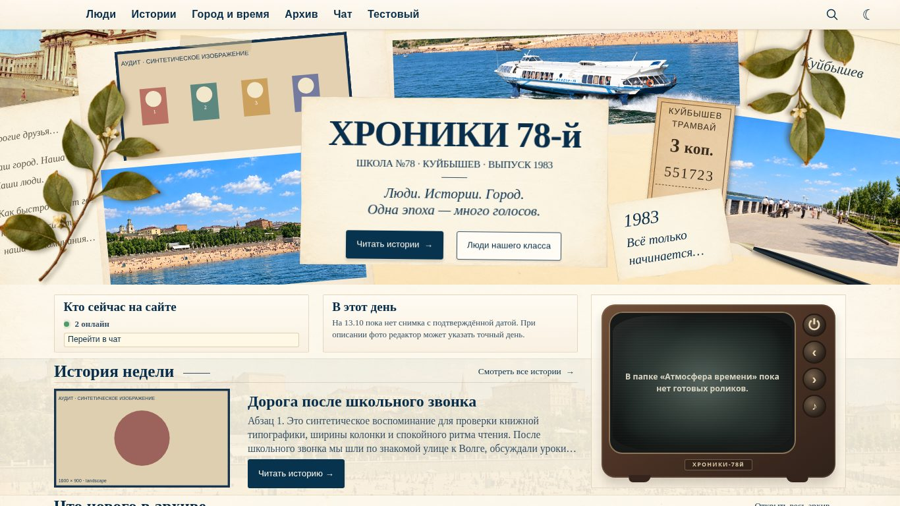 | 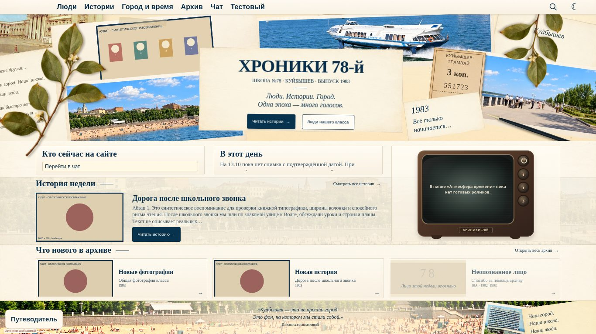 |

v74 допускала вертикальную прокрутку; различие полноты кадра не является самостоятельным доказательством дефекта. Доказательство — вычисленные размеры текста.

**02 — одна и та же запись M-011: меню у верхней границы / посередине. Обе картинки — v81, исправлений нет.**

| У верхней границы | Посередине |
| --- | --- |
| [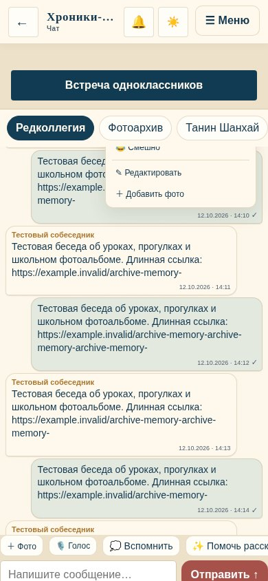](CH78-UI-001/screenshots/focused/390-same-message-menu-5.jpg) | [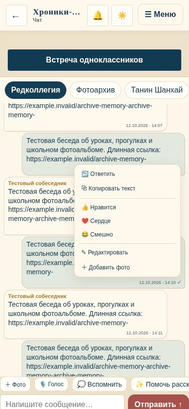](CH78-UI-001/screenshots/focused/390-same-message-menu-275.jpg) |

**03 — native touch в Chromium: до / после отпускания. Обе картинки — v81.**

| До отпускания | После отпускания |
| --- | --- |
| [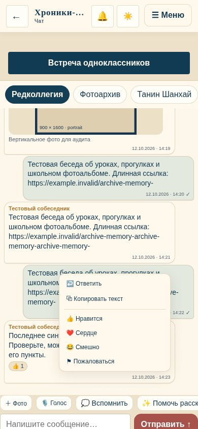](CH78-UI-001/screenshots/focused/390-touch-before-release.jpg) | [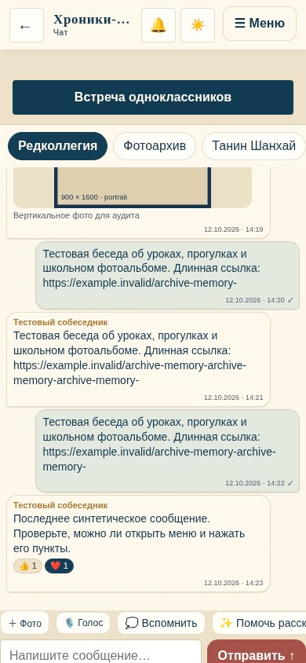](CH78-UI-001/screenshots/focused/390-touch-after-release.jpg) |

**04 — [короткий landscape 568×320](CH78-UI-001/screenshots/focused/568x320-landscape-chat.jpg): composer находится ниже снятого viewport; портретный чат (снимок сохранён локально; публикация ожидает разрешения).**

**05 — admin при 1024 px: v80 / v81.**

| v80 | v81 |
| --- | --- |
| [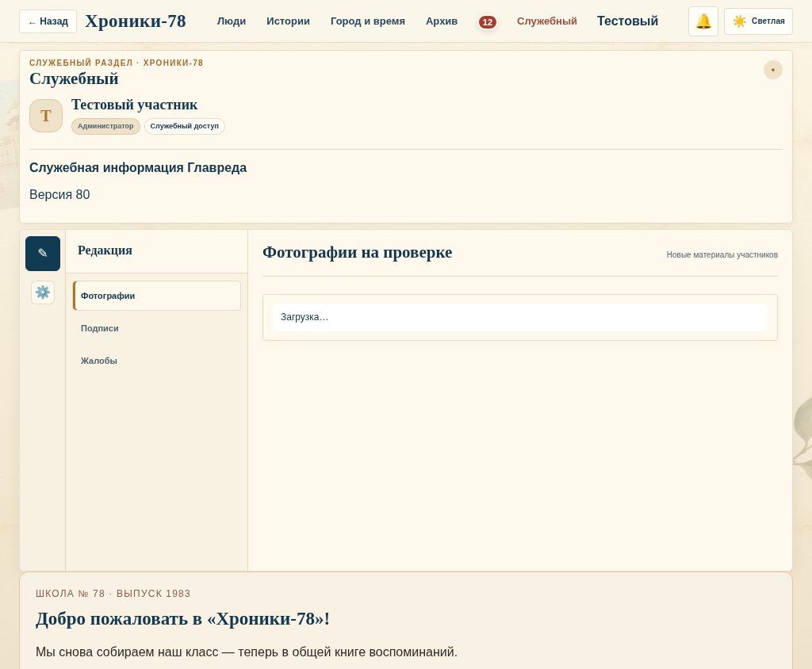](CH78-UI-001/screenshots/focused/v80-1024-admin-profile.jpg) | [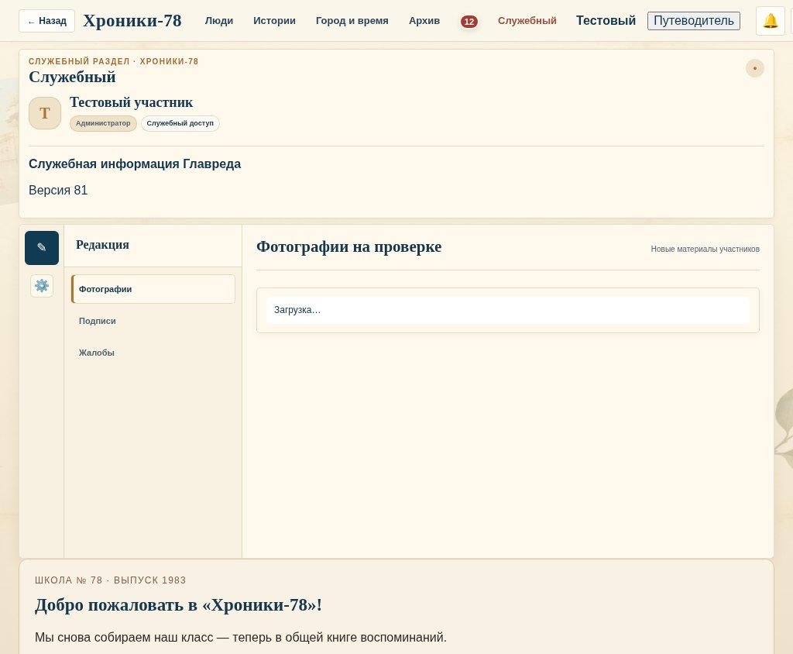](CH78-UI-001/screenshots/focused/1024-admin-profile.jpg) |

Дополнительно: v80 на 768 px (снимок сохранён локально; публикация ожидает разрешения) и v81 на 768 px (снимок сохранён локально; публикация ожидает разрешения). `document.scrollWidth` здесь равен viewport, хотя кнопки обрезаны: одной проверки отсутствия горизонтального скролла недостаточно.

**06 — desktop-панель (снимок сохранён локально; публикация ожидает разрешения) без постоянного пункта вопросов.**

**07 — помощник без гида в v80 / помощник под гидом в v81.**

| v80: помощник | v81: конфликт |
| --- | --- |
| [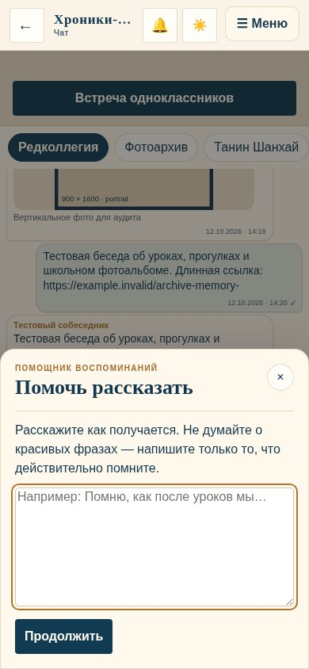](CH78-UI-001/screenshots/focused/390-v80-assistant.jpg) | [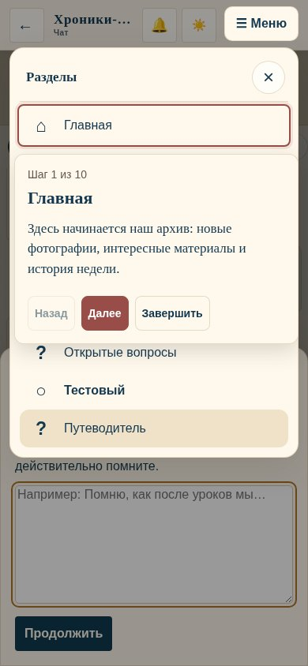](CH78-UI-001/screenshots/focused/390-assistant-guide.jpg) |

Также [приглашение поверх помощника](CH78-UI-001/screenshots/focused/390-assistant-invitation.jpg).

**08 — первый вход (снимок сохранён локально; публикация ожидает разрешения): стандартное окно есть, отдельный archiveWelcome в нём отсутствует.**

**09–10 — чат на 390 px (снимок сохранён локально; публикация ожидает разрешения): синяя primary-кнопка, красная отправка, маленькие инструменты. [Просмотр портретного фото](CH78-UI-001/screenshots/focused/390-portrait-viewer.jpg): размер кнопки закрытия.**

**11 — верхняя панель читателя (снимок сохранён локально; публикация ожидает разрешения): нативная рамка «Путеводителя».**

**12 — unread=12 / unread=0, один и тот же навигатор v81. Это диагностические состояния, не исправление.**

| unread=12 | unread=0 |
| --- | --- |
| [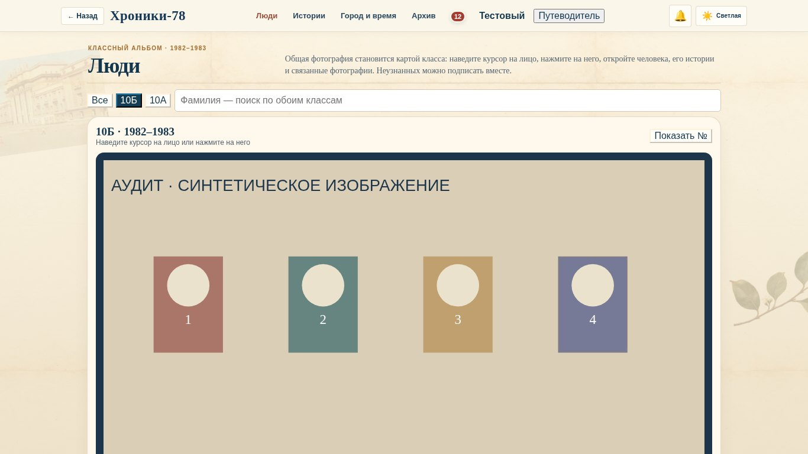](CH78-UI-001/screenshots/focused/1366-badge-12.jpg) | [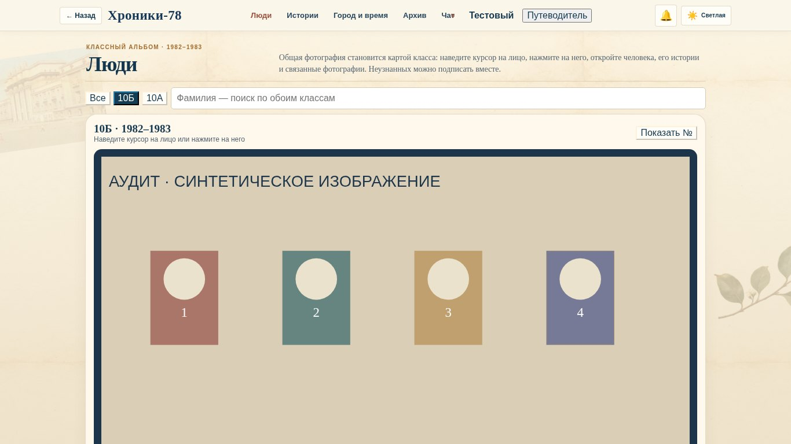](CH78-UI-001/screenshots/focused/1366-badge-0.jpg) |

## 5. Причины регрессий

1. **Геометрический масштаб используется как типографический.** На 1366×768 `--home-unit = min(13,66px,10,24px) = 10,24px`; размер кнопки `0,97 × 10,24 = 9,93px`. Минимум для nav-заголовков задан через clamp, для основных действий/текста — нет. Высота `100dvh` запрещает компоновке расшириться.
2. **CSS старой боковой навигации сохранился после её замены.** Особенно показателен абсолютный unread badge: для широкой sidebar-кнопки место было, в узкой верхней ссылке он перекрывает весь текст.
3. **Новый элемент добавляется в уже тесную строку без проверки занимаемой ширины.** В изолированном браузерном эксперименте удаление только guideEntry из desktop-панели снижает scrollWidth 1039→1024 при 1024 px. Это причинный эксперимент, а не правка исходников.
4. **Несколько компонентов считают высоту независимо.** `main` добавляет padding, chat вычитает только header, messages сохраняет минимум 280 px; в коротком экране сумма не помещается.
5. **Контейнер и событие меню не согласованы.** Меню находится внутри clip/scroll-предка и открывается жестом, финальный click которого закрывает его.
6. **Нет полной картины открытых панелей.** В guide.js перечислены отдельные модальные контейнеры, но помощник имеет другую структуру и пропущен.
7. **Перенос общих компонентов выполняется не для всего связанного содержимого.** LoginBox перемещён в accountHost, инструкция осталась в profile.
8. **Палитра определяется и root-темой, и body-токенами, и прямыми цветовыми правилами.** Это даёт разные primary-цвета внутри и вне `.view`.

## 6. Архитектура CSS

### Фактический порядок подключения

`guide.css` → `app.css` → `mobile-archive.css` → inline `photoScallopStyle` → `design-tokens.css` → `home-2.css` → `community.css` → `chapters.css` → inline `archiveWelcome` → `meetings-navigation.css` → `archive-player.css`.

`home-reference.css` существует (526 строк), но **не подключён в текущем index.html**. `home-v61.css` также не подключён. Служебные публичные страницы имеют собственный `public-info.css`; нельзя обвинять неиспользуемый файл в текущем конфликте Home. В загружаемых app/mobile-archive при этом остаются правила предыдущих Home-композиций — их использование нужно инвентаризировать, а не удалять файлы целиком.

| Загруженный файл | CSSOM-правила | Декларации `!important` | Повторяющиеся пары селектор + контекст |
| --- | --- | --- | --- |
| app.css | 1913 | 1369 | 141 |
| mobile-archive.css | 140 | 871 | 6 |
| home-2.css | 373 | 113 | 64 |
| community.css | 176 | 76 | 6 |
| chapters.css | 37 | 4 | 2 |
| meetings-navigation.css | 63 | 72 | 1 |
| guide.css | 25 | 1 | 0 |
| archive-player.css | 18 | 5 | 0 |
| design-tokens.css | 2 | 0 | 0 |
| Inline-блоки | 9 | 1 | 0 |

Всего — **2512 деклараций `!important`** в загруженных стилях. Среди повторов одной пары selector/context: `.photoTileImage img` — 6 правил, `.photoTileImage` — 5, `main` и `#home` — по 4. Повтор сам по себе не доказательство дефекта: свойства могут дополнять друг друга, а динамические/editor-состояния различаться.

### Подтверждённые конфликты каскада

- `mobile-archive.css:78` задаёт минимум 44 px, но `.filterRail .mini` в `app.css:317–322` имеет более высокую специфичность и оставляет 40 px. Исправлять исходное правило компонента, а не добавлять ещё один `!important`.
- Светлая палитра `app.css:2386–2405` задаёт красный primary; `chapters.css:2` меняет наследуемый primary на синий, а правило раздела `chapters.css:19` специфичнее светлого `.primary`. При этом прямое правило `.send` остаётся красным.
- `community.css:2–3` разрешает Home auto-height/scroll; `meetings-navigation.css:67–69` позднее снова устанавливает `100dvh` и `overflow:hidden!important`. Победившее ограничение вызывает компромисс масштаба текста; выбрать одного владельца размеров Home.
- `app.css:1508–1512` оставляет центрирование и минимум 88 px для промежуточной навигации. `chapters.css:25` задаёт grid-template-columns, хотя применённый display остаётся flex: это не ограничивает число/суммарную ширину кнопок.
- `app.css:1828–1839` позиционирует badge как в sidebar, а `app.css:2971–2976` делает nav узкими верхними ссылками. Контейнерная область старого правила не ограничена.
- Inline `photoScallopStyle` и последующие мобильные исключения меняют фигурный край. В проверенных mobile-снимках пропорции сохранены; нельзя удалять эти исключения ради очистки CSS до приёмки реальных фото.

Медиазапросы используют несколько рубежей: 600, 760/761, 820, 900 и 1024 px. Home, рабочие разделы, контекстные окна, навигация и guide могут одновременно выбирать разные режимы. План предусматривает согласование ответственности, а не новый роутер или массовый rewrite.

### Кэширование и темы

Новые ресурсы гида имеют `20261013-81`; app/traffic имеют `20261013-80`; неизменённые ресурсы остаются `20261011-79`. Само различие параметров версии не ошибка. `version.json` использует Jekyll build_revision и переключает адрес по SHA. Подтверждений устаревшего содержимого из кэша нет; живой клиентский кэш не проверялся.

На стенде light остаётся light при dark ОС (`color-scheme: only light`); dark-режим читателя также проверен. Расширения, авто-затемнение конкретных мобильных браузеров и пользовательские масштабирования отдельно не проверялись.

## 7. Мобильная версия и планшет

| Ширина / высота основного прогона | Результат |
| --- | --- |
| 320×568 | Основные разделы/окна открываются; composer заканчивается на y=580; малые кнопки; меню сообщения обрезается |
| 375×844 | Composer заканчивается на y=856; остальные подтверждённые мобильные проблемы воспроизводятся |
| 390×844 | То же; дополнительно выполнены функциональные действия, native touch-жест и светлая/тёмная темы |
| 430×844 | То же; формы/изображения в основной матрице не дают горизонтального скролла |
| 768×1024 | Home выбирает desktop-композицию с текстом 7–9 px; навигация рабочего раздела выходит за обе границы, хотя doc.scrollWidth остаётся 768 |

На телефоне действуют **«☰ Меню» и общая панель разделов**; нижняя навигация намеренно скрыта после v75. Её отсутствие не зарегистрировано как дефект. На 768 px неожиданно остаётся и старый пункт «Ещё», и полный ряд — часть конфликта промежуточного режима.

В 568×320 поле ввода чата уходит целиком ниже viewport; это воспроизведено без физической экранной клавиатуры. В 844×390 интерфейс уже выбирает промежуточный, а не телефонный режим. Путеводитель в проверенных landscape-окнах остаётся в пределах viewport и может использовать текст без подсветки.

Проверены фото в портретных, пейзажных и панорамных пропорциях. После загрузки в mobile-галерее применяется contain; например, исходный портрет 900×1600 отображается примерно как 320×567. В просмотре портрет имеет 308,58×548,58 — исходное отношение сторон сохраняется.

Области лиц на контрольной картинке совпадают с заданными координатами: в основной матрице отклонение порядка сотых долей пикселя; отдельно переключены 10А/10Б. Это проверка механизма масштабирования, **не** правильности исторической разметки реальных лиц.

Короткий viewport 390×430 с фокусом e-mail: поле находится внутри видимой области и модального окна. Такой тест не воспроизводит поведение физической клавиатуры iPhone/Android и не закрывает эту часть приёмки.

## 8. Десктопная версия

| Ширина / высота | Результат |
| --- | --- |
| 1024×768 | В читателе v81 scrollWidth=1039; у admin дополнительно подтверждён выход переключателя темы за экран. Home слишком мелкий |
| 1366×768 | Общая композиция Home помещается, но текст уменьшен; unread badge накрывает «Чат»; постоянного перехода к вопросам нет |
| 1920×1080 | Home менее тесный, но кнопки около 14 px; menu/badge/доступность вопросов сохраняют выявленные дефекты |

Для admin отдельно проверены 375, 768, 1024 и 1366 px. При 768 px кнопка «Главная» целиком уходит левее viewport; при 1024 px тема в v81 оказывается практически целиком справа. В v80 admin при 1024 px помещается. Наиболее важная для главреда регрессия — UI-001-05.

Полный текст истории остаётся книжным; главное уменьшение касается Home, а не всего читателя. В обычном просмотре фотографий принудительную обрезку/деформацию не выявили. Desktop-превью отдельных карточек используют cover: это кадрирование миниатюры, а не потеря оригинала. Без эталона и реальных снимков нежелательность такого кадрирования не утверждается и в подтверждённый реестр не включена.

## 9. Функциональные регрессии и сохранённое поведение

Финальный набор содержит 21 проверку, все прошли. Данные, результаты записи и внешний сервис распознавания подменены в памяти стенда.

| Группа | Что реально выполнено |
| --- | --- |
| Первый вход | Пустой e-mail, отсутствие имени/согласия, некорректная длина OTP дают ошибки UI |
| Навигация | Настоящие клики мобильного меню переходят во все основные разделы |
| Люди | 10А/10Б, геометрия областей, поиск по обоим классам, карточка, отправка синтетического предложения имени |
| Истории | Настоящая кнопка используемого каталога `[data-community-story]` открывает storyProse; Escape закрывает читателя |
| Чат | Отправка, реакция, read/reply-разметка, входящее сообщение через callbacks realtime; позиционирование меню проверено отдельно и выявило дефекты |
| Голос | MediaRecorder с fake-device записывает звук; перехваченный voice-transcribe возвращает текст в composer. Настоящая транскрипция не проверялась |
| Фото / видео | Реальный клик фото-карточки и просмотр; настоящий двухсекундный WebM с аудио в постоянном плеере, локальный URL |
| Город | Синтетический комментарий добавляется и обновляет UI; музыкальный iframe имеет подставленную страницу, воспроизведение Яндекс Музыки не проверено |
| Вопросы | Карточка открывает обсуждение и подставляет вопрос в composer |
| Профиль | Анкета «Тогда / Сейчас» открывается и сохраняет синтетический текст; file-input присутствует, реальная загрузка файлов не выполнялась |
| Путеводитель | Оба сценария завершаются и закрывают принадлежащее гиду меню/рамку; конфликт с помощником зарегистрирован отдельно |
| Встречи | Создаётся ссылка на комнату; внешний сервис изолирован, реального звонка нет |
| Технические проверки | Ошибок JS в финальных сценариях нет; реальных обращений к Supabase нет |

Проверен синтаксис 18 JS-файлов: ошибок нет. Штатные предыдущие проверки не заменяют новые случаи: старые наборы не проверяли обрезание admin-навигации при 768/1024, release-событие долгого нажатия и helper-modal поверх гида. Эти случаи нужно добавить перед исправлением как отдельные регрессионные проверки.

## 10. Рекомендуемые исправления

1. Сначала закрыть P1 управления: жест/меню чата, chat-height, адаптивная навигация, приоритет помощника и гида, реальный вход в вопросы.
2. Для Home согласовать читаемые минимумы и допустимость вертикальной прокрутки низких окон. Сохранять коллаж и функциональные блоки; не возвращать v74 целиком.
3. Исправить исходные компонентные размеры и область действия CSS. Не заменять проблему очередным глобальным override.
4. Возвращать палитру к заданной концепции через существующие переменные и компоненты. Исключить изменение исторических материалов и данных.
5. Закрепить текущие удачные решения: мобильный фотоархив с естественными пропорциями, точное масштабирование лиц, книжный storyProse, постоянный плеер, улучшенные карточки участников, действующий OTP/согласие.

## 11. Риски

- Изменение высоты Home может затронуть ранее требовавшуюся композицию в один экран. Предлагается сохранять один экран, когда читаемые минимумы помещаются, и разрешать вертикальную прокрутку на низких/тесных окнах; это решение требует утверждения.
- Повсеместное `button{min-height:44px}` сместит координатные области лиц. Минимумы должны быть компонентными.
- Снятие большого числа `!important` без проверки light/dark, editor/admin и legacy-контейнеров создаст новые регрессии. Массовое удаление не предлагается.
- Изменение breakpoint должно одновременно учитывать CSS, текущее меню, `matchMedia` мобильного модуля и guide. Нельзя получить третью параллельную навигацию.
- Исправление высоты чата должно сохранить работу `--archive-dock-height`, поведения прокрутки и реакции на загрузку вложений.
- Перенос текста инструкции не должен менять e-mail/OTP, регистрацию, согласие, RLS или профильные guard.

## 12. Последовательный план реализации

Все этапы ниже — **предложение**, а не выполненные изменения. Каждый этап — отдельный небольшой PR/коммит с собственной проверкой.

| Этап | Объём | Приёмка | Оценка |
| --- | --- | --- | --- |
| UI-001A | 02,03,05,06,07,12: меню/жесты, адаптивная навигация, вопросы, приоритет модальных окон и badge | Видимые и доступные пункты на 768/1024 для member/admin; все меню-пункты; release не закрывает открывающий жест; помощник не перекрыт гидом | 6–10 ч |
| UI-001B | 01,09,11: читаемая типографика Home, согласованная палитра, оформление guideEntry | Утверждённые снимки 768/1024/1366/1920; измеримые минимумы текста; единый primary; сохранена архивная композиция | 6–10 ч |
| UI-001C | 04,10: владелец высоты чата, короткие окна, выбранные области нажатия | Composer видим до/после фокуса, с плеером и без; 320/375/390/430 и landscape; физические клавиатуры | 4–8 ч |
| UI-001D | 08 и контроль фотографий/видео/форм: существующая инструкция в правильном host, устойчивые окна | Процесс входа прежний; портрет/панорама не деформированы; file-input и плеер работают; материалы не изменены | 3–6 ч |
| UI-001E | Точечная очистка активных конфликтов CSS: убрать дублирование ответственности, ограничить legacy-селекторы | Все принятые снимки предыдущих этапов сохраняются; нет массового rewrite/замены дизайна | 6–10 ч |
| UI-001F | Финальная визуальная и функциональная приёмка | Весь набор регрессий, реальные Safari/iOS и Android, сессия участника, проверка главным редактором | 3–6 ч |

Ориентир: **28–50 часов, примерно 4–7 рабочих дней**, без ожидания решений по эталону и доступа к физическим устройствам. Это оценка для последовательных небольших изменений; полный rewrite не требуется.

После утверждения сначала UI-001A; дальнейшие изменения сверять с принятой картой дефектов. Merge в main и публикация требуют отдельного согласования для соответствующих исправлений.

## 13. Ограничения, методика и приложения

- Исходники взяты из свежего main; рабочая ветка `audit/ch78-ui-001`. Производственный HTML/CSS/JS, Supabase, регистрация, RLS и пользовательские данные не изменены.
- Chromium 151.0.7922.173, Playwright 1.62.1, locale ru-RU, часовой пояс Europe/Samara. Система — Linux; это не Safari и не физические iPhone/Android.
- 8 размеров основной матрицы: 320,375,390,430,768,1024,1366,1920. Контрольные landscape: 568×320 и 844×390; дополнительно обычные 1024×768/1366×768. Для форм выполнен короткий viewport 390×430.
- Данные закрытых разделов — синтетические. Они не доказывают корректность всех реальных файлов, лиц, прав, подписей, персональных анкет и состояний базы.
- Браузерные запросы подменяются Playwright routes. Настоящие письмо/OTP, распознавание речи, приватные Drive-файлы, Яндекс Музыка и Jitsi не проверены.
- Проверена опубликованная ревизия через статус GitHub Pages. Прямой просмотр живого github.io и реального клиентского кэша в этой среде недоступен; сравнение выполнялось локально на точных исходниках.
- Снимки и геометрия собраны до исправлений. Различия между старой и новой версией не названы дефектами автоматически. Для причинных случаев использованы координаты, computed style, hit-testing, native touch и изолированные состояния одного компонента.
- Все 473 исходных JPEG и полные сырые измерения сохранены в рабочей среде аудита. В документацию приложен выбранный набор доказательств и Home-сравнений; основной журнал содержит 432 строки наблюдений. Пиксельный diff не используется как единственное доказательство.

Приложения:

- [Журнал основной матрицы CSV](CH78-UI-001/matrix-summary.csv).
- [История последних 30 коммитов](CH78-UI-001/history.tsv).
- [Статистика CSS и повторов](CH78-UI-001/css-analysis.json).
- [Результаты функциональных проверок](CH78-UI-001/functional-results.json).
- [Дополнительные измерения](CH78-UI-001/extra-results.json).
- [Измерения жестов, badge и пропорций](CH78-UI-001/evidence-results.json).
- [Синтаксис JS](CH78-UI-001/syntax-results.json).
- [Снимки Главной всех восьми ширин](CH78-UI-001/SCREENSHOTS.md).

**Диагностический этап завершён. К исправлениям не приступали. План UI-001A–F ожидает утверждения главреда.**
